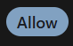
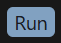
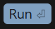

# AI Agent Approval Alert

**Never miss a paused coding agent again.** AI Agent Approval Alert is a lightweight screen watcher for Cursor and other AI coding assistants. It plays a repeating audio alert for as long as an agent is waiting on an **Allow** or **Run** approval button.


<p>
  
  
  
</p>

---

## The problem

Agentic coding tools such as Cursor's Agent mode stop and wait for you to approve terminal commands, tool calls and file edits. If you've moved to another window, another monitor or another task, the agent can sit idle for minutes or hours before you notice.

## The solution

`approval_alert.py` watches **every monitor** for the agent's approval buttons. Whenever one shows up, it plays a soft chime and **repeats it every 2 seconds until the button is gone**, so the notification persists until you respond.

- **Persistent alerts:** the chime keeps repeating until you approve or reject the prompt.
- **Multi-monitor:** scans the whole virtual desktop on every cycle.
- **Never clicks:** detection only. It never moves the mouse or presses a button for you, so you stay in control of what the agent runs.
- **No OpenCV:** template matching is written in pure NumPy (FFT-based normalized cross-correlation), so it also runs on **Windows on ARM**.
- **DPI- and scale-tolerant:** handles display scaling (125%, 150%, …) and small size differences between the captured button and the one on screen.
- **Works with any agent UI:** capture a screenshot of any button (Cursor, VS Code, Windsurf, Claude Code, GitHub Copilot, a terminal prompt…) and it will watch for that button too.

## Quick start

```bash
git clone https://github.com/KenThorburn/ai-agent-approval-alert.git
cd ai-agent-approval-alert
pip install -r requirements.txt
python approval_alert.py
```

The repo includes templates for Cursor's dark-theme **Allow**, **Run** and **Run ⏎** buttons in [`templates/`](templates/). If your theme, font or zoom level looks different, capture your own (see below).

Press **Ctrl+C** to stop.

## Capturing your own buttons

Each button you want to detect needs a template image. To capture one, make sure the button is visible on screen, then run:

```bash
python approval_alert.py --capture allow_button
```

1. You get a 5-second countdown. Put your mouse on the button's **top-left corner**.
2. You get a second 5-second countdown. Put your mouse on the button's **bottom-right corner**.
3. The crop is saved as `templates/allow_button.png`.

Every PNG in `templates/` is loaded automatically, so you can capture as many buttons as you want (`run_button`, `accept_all`, `continue`, …).

## Command-line options

| Option | Default | Description |
| --- | --- | --- |
| `--capture NAME` | n/a | Capture a new button template to `templates/NAME.png`. |
| `--template PATH` | n/a | Watch for an extra template PNG stored outside `templates/`. Can be given more than once. |
| `--interval SECONDS` | `1.0` | Time between screen scans. |
| `--threshold 0-1` | `0.88` | Match confidence required to count as a hit. Lower it if real buttons are missed; raise it if you get false alerts. |

Examples:

```bash
python approval_alert.py --interval 2 --threshold 0.86
python approval_alert.py --template C:\path\to\accept_button.png
```

## How it works

1. **Capture:** [`mss`](https://github.com/BoboTiG/python-mss) grabs the full virtual desktop (all monitors) and converts it to grayscale.
2. **Coarse search:** the screen and each template are downscaled, and a zero-mean normalized cross-correlation (ZNCC, the same measure as OpenCV's `TM_CCOEFF_NORMED`) is computed with an FFT. Several template scales are tried to cope with display scaling.
3. **Fine verification:** each candidate is re-checked at full resolution on a small patch, which filters out things that only look similar.
4. **Alert:** while any button is found, a quiet C-major arpeggio is synthesized in memory and played every 2 seconds. When the button disappears, the alert stops.

All sums use float64 integral images, so large multi-monitor desktops don't produce false positives from precision loss.

## Requirements

- **Windows 10/11** (x64 or ARM64). Audio uses the built-in `winsound` module.
- **Python 3.9+**
- `numpy`, `pillow`, `mss`, `pyautogui` (installed from `requirements.txt`)

> macOS and Linux are not supported yet because `winsound` is Windows-only. The detection code is cross-platform, so a pull request that adds another audio backend is welcome.

## Troubleshooting

| Symptom | Fix |
| --- | --- |
| The button is on screen but there is no alert | Recapture the template at your current theme and zoom level, or lower `--threshold` (for example to `0.82`). |
| Alerts fire when no button is visible | Raise `--threshold`, or recapture a tighter crop that contains only the button. |
| High CPU usage | Increase `--interval` (for example to `2`). |
| `warn:` messages in the console | Usually a transient capture error (locked screen, monitor asleep). The watcher keeps running. |

## FAQ

**Does it auto-approve or auto-click anything?**
No. It only observes the screen and plays a sound. Approving agent actions is left to you on purpose.

**Does it send any data anywhere?**
No. Screenshots are processed in memory and are never saved or sent anywhere.

**Will it work with Claude Code, Copilot, Windsurf, Cline or Aider?**
Yes, as long as the tool shows a visible button or prompt on screen. Capture that button with `--capture` and it will be watched like the others.

## Contributing

Issues and pull requests are welcome, especially:

- macOS and Linux audio backends
- desktop toast notifications as well as the sound
- templates for other IDEs, themes and agents

## License

[MIT](LICENSE)

---

<sub>Keywords: Cursor AI notification, Cursor agent waiting for approval, AI coding agent alert, Allow button detector, Run command approval sound, agent mode paused, human-in-the-loop notifications, screen watcher, template matching in Python, productivity tool for vibe coding.</sub>
